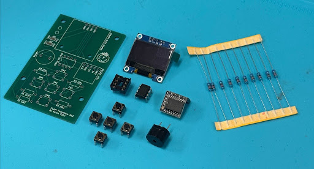

# Pocket Pomodoro 

## Overview 
Here's the instructions and resources to build your very own Pomodoro! In this repository you'll find a BOM (Bill of Materials), Instruction Set, 3D Files, and PCB designs. 

# Instructions
The instructions are setup into multiple subgroups in order to better organize the project and make it easier to setup.

## What You'll Need

### Parts
- **Electronics:** everything is listed, with quantities and links, in the [BOM](./BOM/BOM%20-%20Pomodoro%20Timer.csv).
- **3D-printed parts:**
  - Top case (with the screen window, 5 button holes, and buzzer grille)
  - Battery holder (the base, with a slot for the slide switch)
  - PCB mounting plate (the black plate that sits between the battery holder and the PCB)
  - 5 button caps
- **Wire:** two short red wires and one short black wire (cut-down jumper wires work fine)

### Tools
- Soldering iron and solder (this build used 0.8 mm 60/40 rosin-core)
- Flush cutters
- Wire strippers
- Needle-nose pliers
- Tweezers
- Electrical tape
- 2.5 mm hex key (for the M3 socket-head screws)
- Recommended: a silicone work mat and a fume extractor

> **Safety:** 60/40 solder contains lead. Work somewhere ventilated and wash your hands when you're done.

## Assembling the PCB
