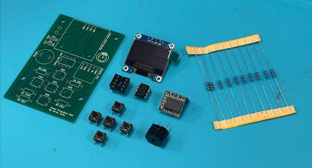

# Pocket Pomodoro 

## Overview 
Here's the instructions and resources to build your very own Pomodoro! In this repository you'll find a BOM (Bill of Materials), Instruction Set, 3D Files, and PCB designs. 

# Instructions
The instructions are setup into multiple subgroups in order to better organize the project and make it easier to setup.

## Assembling the PCB